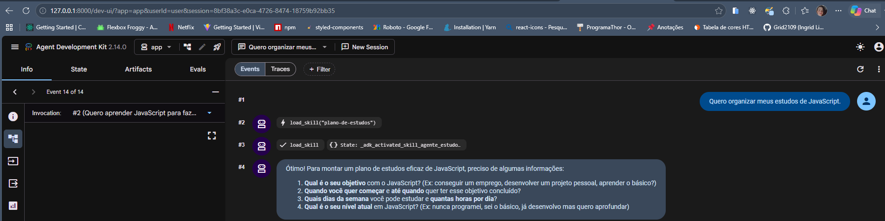
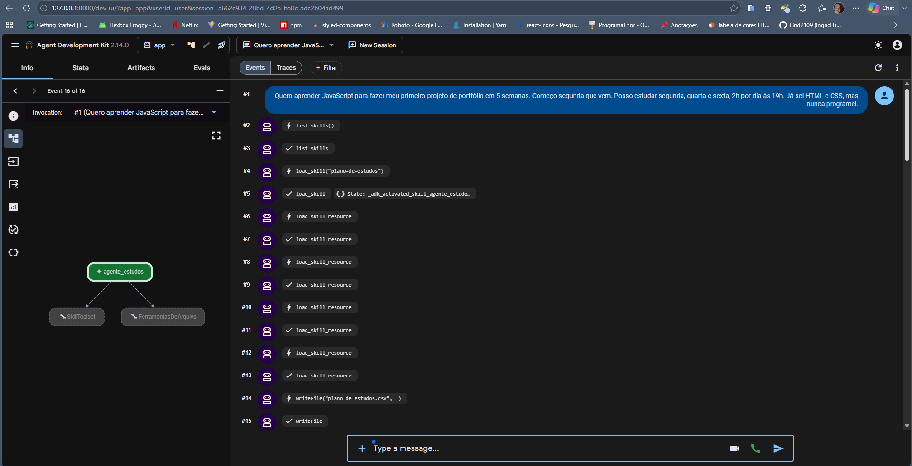
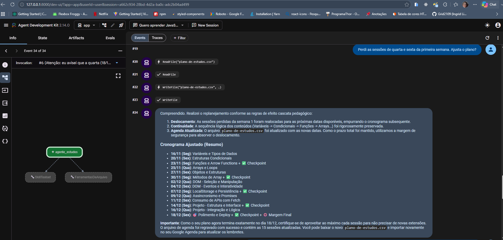

# Agente de Estudos - Mentor Personalizado com Google ADK

Este projeto consiste em um agente autônomo especialista em planejamento e mentoria de estudos, construído com o Google Agent Development Kit (ADK) em Python e integrado aos modelos generativos Gemini.

O objetivo do agente é transformar metas de aprendizado em cronogramas executáveis no mundo real, com distribuição de tópicos, revisões espaçadas, pontos de autoavaliação e exportação de uma agenda em formato CSV pronta para ser importada no Google Agenda. Além do cronograma, o agente também disponibiliza uma skill de revisão ativa para geração de flashcards atômicos e simulados práticos.

---

## Arquitetura e Engenharia do Agente

O desenvolvimento do agente priorizou boas práticas de engenharia de software com inteligência artificial, segurança de execução e otimização de contexto:

1. Divulgação Progressiva de Skills (Agent Skills Specification):
   Para evitar sobrecarga de contexto e consumo desnecessário de tokens na inicialização, as habilidades do agente foram implementadas segundo o padrão de divulgação progressiva:
   - Nível 1 (Metadados): Na inicialização, o agente carrega apenas nome e descrição das skills para descoberta.
   - Nível 2 (Instruções e Gating): O corpo da skill e suas regras de ativação são lidos sob demanda somente quando a intenção do usuário demanda aquela competência.
   - Nível 3 (Recursos Especializados): Documentos de suporte, fluxos de trabalho, regras de exportação e templates em formato Markdown são carregados dinamicamente apenas no momento exato em que são necessários.

2. Ferramentas de Arquivo Seguras (EnvironmentToolset):
   O agente tem acesso ao sistema de arquivos local restrito à pasta de planos por meio de uma subclasse customizada do EnvironmentToolset. Para manter a segurança da execução, apenas as operações de leitura (ReadFile) e gravação (WriteFile) foram expostas, sem acesso a comandos de terminal ou shell do sistema operacional.

3. Provedor de Instruções Dinâmico (Instruction Provider):
   Para permitir que o agente compreenda datas relativas (como "segunda que vem" ou "daqui a duas semanas") sem alucinações de calendário, implementei um provedor dinâmico que injeta a data atual do sistema e as referências exatas dos próximos dias da semana em tempo de execução.

---

## Habilidades do Agente (Skills)

O agente conta com duas skills modulares principais:

1. plano-de-estudos:
   - Regra de Ativação (Gating): Sem objetivo claro, prazo, disponibilidade semanal e nível atual, o agente recusa a montagem antecipada e faz perguntas focadas para coletar os dados faltantes.
   - Metodologia de Aprendizagem: Organiza módulos com prioridades, aplica intervalos de revisão espaçada (D+1, D+3 e D+7), checkpoints semanais de autoavaliação e reserva técnica de dias de margem para absorção de imprevistos.
   - Exportação para Google Agenda: Gera e grava um arquivo CSV válido no padrão do Google Agenda respeitando os dias e horários informados.
   - Replanejamento Resiliente: Quando o estudante relata sessões perdidas, o agente utiliza primeiro os dias de margem planejados para absorver o atraso, sem empilhar múltiplos conteúdos no mesmo dia e mantendo o prazo acordado.

2. revisao-ativa:
   - Recebe anotações, resumos, trechos de código ou temas de estudo.
   - Elabora flashcards focados no princípio de atomicidade (uma única pergunta direta por cartão e resposta concisa).
   - Constrói um quiz de fixação de 5 perguntas de múltipla escolha com distratores realistas, acompanhado de gabarito comentado e justificativas conceituais.

---

## Ambiente de Execução

O projeto foi concebido para rodar no ambiente de nuvem do Google Cloud Shell, mas sua arquitetura é totalmente agnóstica de infraestrutura. Validei e executei o fluxo tanto na nuvem quanto em ambiente de desenvolvimento local, comprovando a portabilidade do agente com o uv e o Google ADK.

---

## Como Executar

### Pré-requisitos

- Ambiente: Google Cloud Shell ou máquina local (Linux, macOS ou Windows).
- Python: versão 3.11 a 3.13 (o arquivo pyproject.toml restringe a execução a essa faixa).
- Gerenciador de pacotes uv: ferramenta rápida para gestão de ambientes Python. Para instalar o uv, siga o guia oficial em [docs.astral.sh/uv](https://docs.astral.sh/uv/getting-started/installation/).
- Chave de API do Google AI Studio: gerada gratuitamente em [aistudio.google.com/apikey](https://aistudio.google.com/apikey).

### Passo a passo

1. Clone o repositório e acesse a pasta do agente:
   ```bash
   git clone https://github.com/Grid2109/imersao-eng-soft-agy-agente-adk
   cd imersao-eng-soft-agy-agente-adk/agente-estudos
   ```

2. Configure o arquivo de ambiente:
   ```bash
   cp .env.example .env
   ```

   Abra o arquivo `.env` e preencha com sua chave de API e configurações:
   ```env
   GOOGLE_GENAI_USE_VERTEXAI=FALSE
   GEMINI_API_KEY=sua-chave-aqui
   MODEL=gemini-3.8-flash
   ```
   Caso o modelo 3.8 apresente instabilidade temporária (erro 503), altere para `MODEL=gemini-2.5-flash`, conforme detalhado na seção de Solução de problemas.

3. Sincronize as dependências e o ambiente virtual:
   ```bash
   uv sync
   ```

4. Inicie o servidor do ADK Web:
   ```bash
   uv run adk web --allow_origins="*"
   ```

Abra o endereço `http://127.0.0.1:8000` indicado no console e selecione o agente `app` para iniciar a interação.

> Aviso de cota: A chave gratuita do Google AI Studio possui limites de requisições por minuto (RPM) e por dia (RPD). Em testes frequentes, erros transitórios de cota (rate limit) são esperados.
>
> Aviso de segurança: O ADK Web serve só para desenvolvimento e depuração, não para produção. O parâmetro `--allow_origins="*"` foi utilizado para viabilizar testes locais e proxies de desenvolvimento, mas não deve ser utilizado em servidores expostos diretamente na internet.

---

## Prompts para Validação do Agente

Para testar o agente nos cenários previstos no projeto, utilize os seguintes exemplos:

1. Teste de Gating (pedido incompleto):
   ```text
   Quero organizar meus estudos de JavaScript.
   ```
   O agente deve responder solicitando apenas os dados que faltam (prazo, disponibilidade e nível atual) sem carregar recursos pesados.

2. Teste de Plano Completo e Gravação do CSV:
   ```text
   Quero aprender JavaScript para fazer meu primeiro projeto de portfólio em 5 semanas. Começo segunda que vem. Posso estudar segunda, quarta e sexta, 2h por dia às 19h. Já sei HTML e CSS, mas nunca programei.
   ```
   O agente deve apresentar a visão geral, cronograma com checkpoints e salvar o arquivo `agente-estudos/planos/plano-de-estudos.csv`.

3. Teste de Replanejamento:
   ```text
   Perdi as sessões de quarta e sexta da primeira semana. Ajusta o plano?
   ```
   O agente deve reorganizar o cronograma absorvendo o atraso pelos dias de margem e sobrescrever o arquivo CSV.

4. Teste de Revisão Ativa:
   ```text
   Estudei sobre Closures em JavaScript. Pode gerar flashcards e um quiz de 5 perguntas?
   ```
   O agente ativa a skill `revisao-ativa` e retorna os cartões de memorização e o quiz comentado.

---

## Importação no Google Agenda

Após a geração do plano pelo agente:
1. Localize o arquivo gerado em `agente-estudos/planos/plano-de-estudos.csv`.
2. No Google Agenda (pelo navegador no computador), acesse: Configurações -> Importar e exportar -> Importar.
3. Selecione o arquivo CSV, escolha a agenda de destino e conclua a importação para visualizar as sessões distribuídas no seu calendário.

---

## Agente em funcionamento

Capturas do ADK Web com o agente respondendo nos cenários de validação.

| Cenário | Imagem |
| :--- | :--- |
| Pedido incompleto: o agente pergunta só o que falta |  |
| Plano completo e gravação do CSV |  |
| Replanejamento após sessões perdidas |  |

---

## Solução de problemas

### Erro 503 (modelo indisponível)

Durante os testes, o `gemini-3.8-flash` devolveu o erro **503** várias vezes. Esse erro significa que o serviço do Google está temporariamente sobrecarregado: o problema não está no seu código nem na sua chave, e costuma passar sozinho.

O modelo principal do projeto continua sendo o **`gemini-3.8-flash`**, que é o foco da imersão. O agente já tenta a chamada 3 vezes antes de desistir. Se o erro persistir, use o modelo reserva:

1. Abra o arquivo `agente-estudos/.env`.
2. Troque a linha do modelo:

   ```env
   MODEL=gemini-2.5-flash
   ```

3. Pare o ADK Web (`CTRL+C`) e rode de novo: `uv run adk web --allow_origins="*"`.

Quando o 3.8 voltar a responder, volte para `MODEL=gemini-3.8-flash`. Se a linha `MODEL` for apagada, o código usa o `gemini-3.8-flash` por padrão. Nos meus testes, essa troca resolveu o erro. Se o modelo reserva sair do ar no futuro, consulte a lista atual em [ai.google.dev/gemini-api/docs/models](https://ai.google.dev/gemini-api/docs/models).

> A troca é manual. O agente não muda de modelo sozinho quando ocorre um 503.

### Erro 401 (chave não aceita)

Esse erro indica que o Google não aceitou a sua chave de API. Confira, nesta ordem:

1. O arquivo é `agente-estudos/.env` (dentro da pasta `agente-estudos`, não na raiz).
2. O nome da variável é exatamente `GEMINI_API_KEY`, sem espaços antes ou depois do `=`.
3. Você substituiu o `<sua-api-key>` pela chave real, sem os sinais `<` e `>` e sem aspas.
4. `GOOGLE_GENAI_USE_VERTEXAI=FALSE` está escrito assim, para usar a chave do AI Studio.
5. Você reiniciou o ADK Web depois de editar o `.env`. O arquivo só é lido quando o programa inicia.
6. A chave está ativa em [aistudio.google.com/apikey](https://aistudio.google.com/apikey). Se ela vazou em algum lugar público, o Google a bloqueia: gere uma nova.

---

## Contexto e Autoria

Este projeto foi desenvolvido por mim a partir do roteiro da Imersão Dev da Alura, disponível no repositório de [John Garrido](https://github.com/johngarrido/alura-imersao-dev-agy).

A skill plano-de-estudos e o arquivo AGENTS.md são provenientes do material do curso, e a ideia inicial da skill revisao-ativa também teve origem no roteiro.

A implementação completa do agente (incluindo o agent.py, a classe FerramentasDeArquivo, o instruction_provider dinâmico e a integração da camada FastAPI/A2A), a criação e detalhamento da skill revisao-ativa, a reescrita das regras de replanejamento no workflow.md e a suíte de testes e validação são de minha autoria.
